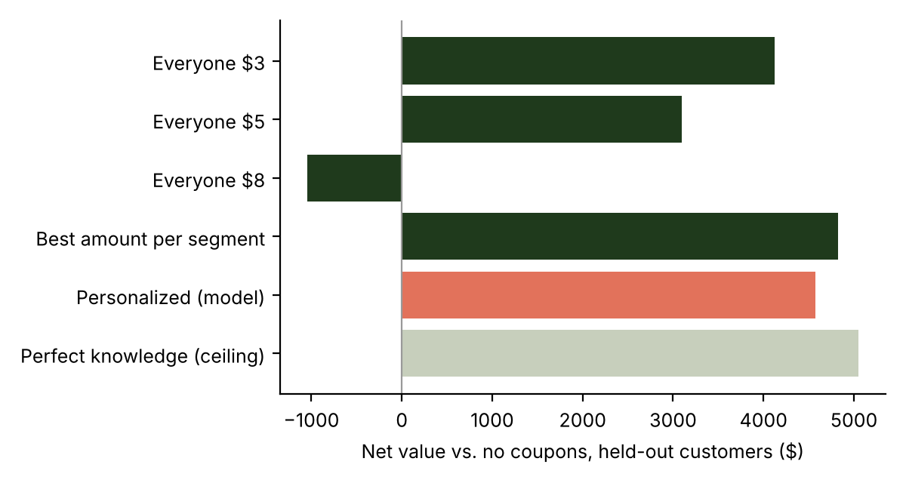

# Who Should Get the Coupon?

A coupon only pays off if it changes what a customer does. This project finds **who a coupon actually moves** and **how big the coupon should be**, then picks who gets what within a budget.

**[Read the full write-up (PDF)](docs/Who_Should_Get_the_Coupon_report.pdf)** · Python · scikit-learn · SQL

> All data are simulated. The numbers describe a scenario, not a real business; the pipeline is the point.

## Highlights

- **Experiment:** a $5-off-$30 coupon lifted conversion from 5.5% to 12.6%, but about 44% of redemptions would have happened anyway.
- **Targeting:** an uplift model, checked on held-out customers, put 58% of the value in the top 30% of customers for 34% of the cost.
- **Coupon amount:** choosing $0, $3, $5 or $8 per customer beat the best single offer by 11% with 31% fewer coupons. Giving everyone $8 lost money.
- **Baseline:** a simple rule by customer segment did about as well as the model, so the write-up tests both.



## Run it

```bash
pip install -r requirements.txt
python src/train.py && python src/evaluate.py      # single-coupon targeting
python src/multi_offer.py                          # coupon amount per customer
python src/run_multi_offer.py --input data/sample_customer_input.csv \
    --output outputs/multi_offer_decisions.csv --budget 100
python -m unittest discover -s tests
```

To use your own coupon test: `python src/train.py --data your_test.csv`.

## What's inside

`src/` pipeline and command-line tools · `sql/` analysis queries · `tests/` 20 tests · `data/` simulated data · `notebooks/` original exploration · `outputs/` results and charts

---
**Protima Tarafdar** · [LinkedIn](https://www.linkedin.com/in/protima-tarafdar/) · MIT License
